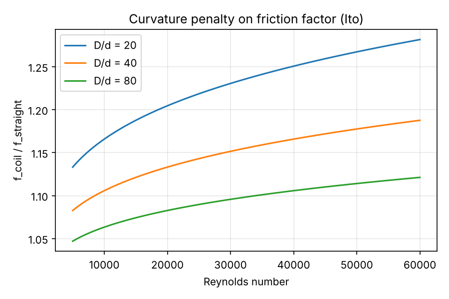

# Helical-Coil Flow Correlations

An analytical baseline for turbulent flow in helically coiled pipes. It computes the friction-factor penalty from coil curvature (Ito 1959) relative to a straight pipe (Blasius), plus Dean number, critical Reynolds number and Darcy-Weisbach pressure drop.

It accompanies my CFD study of single-phase turbulent flow in a helical coil (realizable k-ε, <4% error against published data). A transparent correlation gives a quick check on CFD friction factor and pressure drop.

## Run

```bash
pip install numpy matplotlib pytest
python compare.py   # prints and plots f_coil / f_straight vs Re
pytest              # 7 tests, including validity-range checks
```



At Re = 30,000 the coil friction factor is about 1.23× (D/d = 20), 1.15× (D/d = 40) and 1.10× (D/d = 80) the straight-pipe value. Tighter coils lose more pressure.

## Usage

```python
from coil_flow import friction_coiled_ito, pressure_drop
f = friction_coiled_ito(re=3e4, d=0.01, big_d=0.2)
dp = pressure_drop(f, length=2.0, d=0.01, rho=998, velocity=3.0)
```

Inputs outside the published validity ranges raise `ValueError` rather than returning a silent extrapolation.

## Before citing results

Verify the coefficients in `coil_flow.py` against the paper you validated in Fluent. Replace or add the correlations you actually used.
